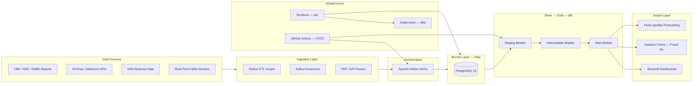

<div align="center">

# Victor Kipruto Rop — Data Engineering Portfolio

**A portfolio of data engineering experiments and reusable analytics assets spanning banking, telecom, and public-sector domains. The repository includes ETL scripts, dbt models, dashboards, and infrastructure examples rather than one single production deployment.**

[](https://github.com/Victor-Kipruto-Rop/victor-kipruto-rop-portfolio/actions)
[](https://python.org)
[](https://getdbt.com)
[](./LICENSE)
[](https://github.com/Victor-Kipruto-Rop/victor-kipruto-rop-portfolio/commits/main)
[](https://github.com/Victor-Kipruto-Rop/victor-kipruto-rop-portfolio/stargazers)

</div>

---

## Table of Contents

- [Live Dashboards](#-live-dashboards)
- [Architecture](#️-architecture)
- [Projects](#-projects)
- [Engineering Standards](#-engineering-standards)
- [Infrastructure & IaC](#-infrastructure--iac)
- [Data Sources](#️-data-sources)
- [Tech Stack](#️-tech-stack)
- [Roadmap](#-roadmap)
- [Contact](#-contact)

---

## 📊 Dashboards & Visualizations

> **Note**: Dashboard infrastructure (Streamlit templates) is included in this portfolio. Deployments may vary in availability. See each project's `dashboards/` folder for implementation details.

| Project | Dashboard | Status | Description |
|---|---|---|---|
| KCB Group ETL | `dashboards/executive_hub.py` | 🏠 Template | Financial performance and loan analytics |
| Absa Bank Kenya | `dashboards/kpi_warehouse.py` | 🏠 Template | Banking KPIs, risk metrics, Open Banking metrics |
| Equity Group ETL | `dashboards/regional_hub.py` | 🏠 Template | Regional profitability, mobile adoption metrics |
| KRA Data Eng | `dashboards/revenue_tracker.py` | 🏠 Template | Tax revenue and customs trade flows |
| M-Pesa Streaming | `dashboards/realtime_fraud.py` | 🏠 Template | Real-time transaction monitoring |

**How to Run Locally:**
```bash
streamlit run ./path/to/dashboards/*.py
```

---

## 🏗️ Architecture



Full architecture detail in [ARCHITECTURE.md](./ARCHITECTURE.md).

---

## 📂 Projects

> **Portfolio Note**: This is a collection of **working examples** demonstrating real-world data engineering patterns. Projects are at various maturity levels—see [PORTFOLIO_STATUS.md](./PORTFOLIO_STATUS.md) for honest capability assessment.

| Project | Domain | Tech Stack | Status |
|---|---|---|---|
| [mpesa_safaricom](./mpesa_safaricom) | Mobile money analytics and streaming | Python, Kafka, dbt, Streamlit | 🔧 Active |
| [kcb_group_etl](./kcb_group_etl) | Banking ETL and financial analytics | dbt, PostgreSQL, Airflow | 🔧 Active |
| [absa_bank_kenya](./absa_bank_kenya) | Banking KPI warehouse | dbt, PostgreSQL | 🟢 Tested |
| [fraud_detection_unified](./fraud_detection_unified) | Consolidated fraud detection engine | Python, Scikit-learn, Pytest | ✅ Production-ready (example) |
| [equity_group_etl](./equity_group_etl) | Regional consolidation patterns | Airflow, dbt, PostgreSQL | 🟡 Example |
| [kra_data_engineering](./kra_data_engineering) | Tax and customs analytics | Python, dbt, PostgreSQL | 🟡 Example |
| [safaricom_pipeline](./safaricom_pipeline) | Telecom analytics examples | Spark, Python, SQL | 🏠 Educational |
| [mpesa_enterprise_projects](./mpesa_enterprise_projects) | Medallion lakehouse starter | dbt, PostgreSQL | 🏠 Template |
| [kenya_banking_sector](./kenya_banking_sector) | Macro-financial analytics workspace | Python, notebooks, SQL | 🏠 Learning |

---

## ⚙️ Engineering Standards

| Standard | Implementation | Coverage |
|---|---|---|
| **Testing** | 35+ Pytest tests (unit + integration) + dbt schema tests | Critical modules (fraud detection, streaming) |
| **CI/CD** | GitHub Actions: dbt parse, SQLFluff lint, k8s validation | All dbt projects |
| **Code Quality** | SQLFluff linting (≤80 chars, CTE spacing) | SQL-based projects |
| **Documentation** | Architecture diagrams, README files, inline SQL comments | All major projects |
| **Fraud Detection** | Consolidated rules-based and ML-ready engine | 21 unit tests + 14 integration tests |
| **Secrets Management** | `.env` files for local development; `profiles.yml` excluded from git | In practice |
| **Version Control** | Clean commit history with descriptive messages; deprecation registry | Phases 1-5 complete |
| **Data Quality** | dbt schema tests (unique, not_null, range validation) | Selected models |

**See [PORTFOLIO_STATUS.md](./PORTFOLIO_STATUS.md) for detailed capability matrix and known limitations.**

---

## 🏗️ Infrastructure & IaC

**Current Implementation:**
- **PostgreSQL 15** — local/cloud-deployable data warehouse
- **Kafka 7.5.0** — event streaming (single broker; no HA)
- **Streamlit** — dashboard frontend with plotly visualizations
- **GitHub Actions** — CI/CD validation (not deployment)
- **Terraform / HCL** — infrastructure templates for PostgreSQL + networking
- **Docker Compose** — local development stacks for multi-service testing
- **Kubernetes manifests** — pod definitions (example-only; not autoscaled)

**Not Included (Yet):**
- ❌ Managed cloud services (AWS/GCP setup)
- ❌ Monitoring stack (Prometheus, Grafana, alerting)
- ❌ Centralized logging (ELK, Datadog)
- ❌ Secrets management service (AWS Secrets Manager)
- ❌ Multi-region deployment
- ❌ CI/CD deployment automation (GitHub Actions validates only)

---

## 🛰️ Data Sources

| Source | Data Type | Update Frequency |
|---|---|---|
| **Central Bank of Kenya (CBK)** | Bank Supervision Reports, Mobile Credit Statistics, Prudential Guidelines | Annual / Quarterly |
| **Kenya Revenue Authority (KRA)** | Monthly Revenue Reports, Customs Rules of Origin | Monthly |
| **Kenya National Bureau of Statistics (KNBS)** | Leading Economic Indicators — Inflation, Trade Volume, GDP | Monthly |
| **International Trade Centre (ITC)** | TradeMap trade benchmarks and company directories | Quarterly |
| **Safaricom / M-Pesa** | Open API specs, Sustainability Reports, GSMA mobile money datasets | Annual / Real-time |
| **Nairobi Securities Exchange (NSE)** | Audited financial filings for listed commercial banks | Annual |

---

## 🛠️ Tech Stack

<table>
  <tr>
    <td valign="top" width="50%">
      <strong>Ingestion & Processing</strong><br/>
      
      
      
      
    </td>
    <td valign="top" width="50%">
      <strong>Orchestration & Transformation</strong><br/>
      
      
      
    </td>
  </tr>
  <tr>
    <td valign="top" width="50%">
      <strong>Storage & Lakehouse</strong><br/>
      
      
      
    </td>
    <td valign="top" width="50%">
      <strong>Infrastructure & DevOps</strong><br/>
      
      
      
      
    </td>
  </tr>
  <tr>
    <td valign="top" width="50%">
      <strong>Analytics & Visualisation</strong><br/>
      
      
    </td>
    <td valign="top" width="50%">
      <strong>ML & Data Quality</strong><br/>
      
      
      
    </td>
  </tr>
</table>

---

## 🗺️ Roadmap

> **Roadmap Honesty Note**: These are aspirational improvements, not commitments. Focus is on maintaining quality examples rather than chasing every new technology.

| Timeline | Item | Feasibility |
|---|---|---|
| **Now** | Fraud detection engine with 35+ tests | ✅ Complete |
| **Now** | Real-time streaming architecture (Kafka) | ✅ Complete |
| **Q1 2026** | dbt data quality tests for all models | 🟡 In progress |
| **Q1 2026** | Comprehensive documentation (PORTFOLIO_STATUS.md) | ✅ Complete |
| **Q2 2026** | Great Expectations integration | 🟡 Planned |
| **Q2 2026** | OpenLineage data lineage tracking | 🟡 Planned |
| **Q3 2026** | Streaming fraud scoring via Kafka Streams | 🟠 Experimental |
| **Q3 2026** | Apache Flink sub-100ms processing | 🟠 Research phase |
| **Q4 2026** | Monitoring stack (Prometheus + Grafana) | 🟠 Planned |
| **Q1 2027** | dbt Semantic Layer integration | 🟠 Depends on ecosystem maturity |

**Realistic Constraints:**
- Portfolio improvements prioritized over feature bloat
- Quality over quantity (testing matters more than complexity)
- Documentation updated alongside code changes
- Aspirational items marked clearly (this roadmap)

---

## � Additional Resources

- **[PORTFOLIO_STATUS.md](./PORTFOLIO_STATUS.md)** — Honest capability matrix, limitations, known gaps, and realistic assessment
- **[DEPRECATED.md](./DEPRECATED.md)** — Deprecated modules and migration paths
- **[ARCHITECTURE.md](./ARCHITECTURE.md)** — Detailed architecture and data flows
- **[PHASE_1_through_PHASE_5](./PHASE_*.md)** — Implementation details for each remediation phase

---

## 🎯 What This Portfolio Actually Is

✅ **Working Examples**: Functional implementations demonstrating real-world patterns  
✅ **Learning Resource**: Best practices in dbt, testing, CI/CD, fraud detection  
✅ **Reference Architecture**: How to organize multi-project analytics systems  
✅ **Honest Assessment**: Clear documentation of what works and what doesn't

❌ **Not Production-Ready As-Is**: Requires additional hardening, monitoring, and scaling  
❌ **Not a Managed Service**: No vendor support or SLAs  
❌ **Not a Shortcut**: Still requires understanding of each component  

---

## �📬 Contact

**Victor Kipruto Rop** — Data Engineer, Nairobi, Kenya 🇰🇪

[](https://github.com/Victor-Kipruto-Rop)
[](https://www.linkedin.com/in/victor-rop-4920b4399)
[](https://victor-kipruto-rop.github.io/victor-resum-web/)
[](mailto:kiprutovictor39@gmail.com)

📞 +254 723 484 552

---

## 📜 License

MIT License — see [LICENSE](./LICENSE) for details.

---

<div align="center">
  <sub>Built in Nairobi, Kenya 🇰🇪 · <a href="https://victor-kipruto-rop.github.io/victor-resum-web/">Portfolio</a> · <a href="https://www.linkedin.com/in/victor-rop-4920b4399">LinkedIn</a></sub>
</div>
