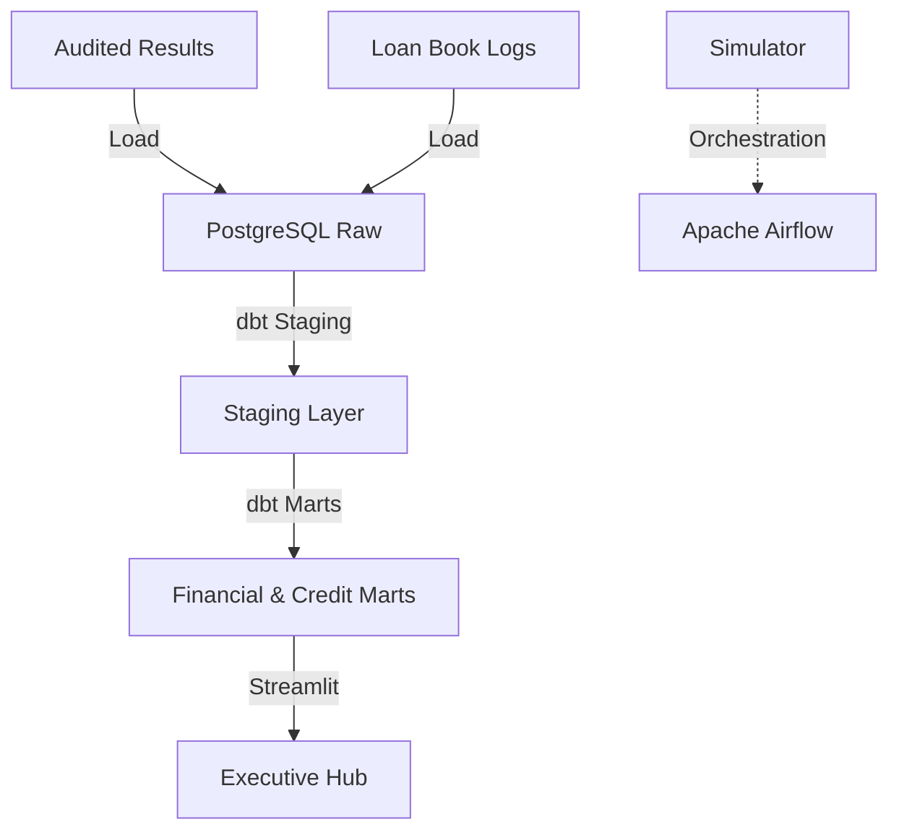

# 🦁 KCB Group Integrated ETL & Analytics Platform

**Status**: 🔧 Active working example (example-level, not production system)

## Overview
This platform manages the ETL and analytical pipelines for KCB Group. it consolidates financial performance data across all regional subsidiaries and provides a detailed vintage analysis of the M-Pesa mobile loan book.

## Architecture


## Data Sources
- **Audited Financials**: FY 2021-2025 Consolidated and Subsidiary reports.
- **M-Pesa Loan Data**: High-fidelity logs of mobile loan disbursements and repayments.

## Tech Stack
- **Orchestration**: Apache Airflow
- **Transformation**: dbt Core (PostgreSQL)
- **Database**: PostgreSQL 15
- **Visualization**: Streamlit, Plotly
- **Environment**: Docker, Docker Compose

## Folder Structure
```text
kcb_group_etl/
├── dags/               # Financial & Credit ETL DAGs
├── dbt/                # Consolidated dbt project
├── ingestion/          # PDF extraction and loan loading
├── dashboards/         # Visualization layer
├── tests/              # dbt and python tests
├── docker-compose.yml  # Local stack definition
└── README.md
```

## How to Run
1. **Launch Stack**:
   ```bash
   docker-compose up -d
   ```
2. **Execute dbt**:
   ```bash
   cd dbt
   dbt run
   dbt test
   ```
3. **Access Dashboard**: Open `http://localhost:8503`

## Key Metrics / Outputs
- **ROE & ROA**: Regional efficiency benchmarking.
- **Vintage Curves**: Default rate evolution by disbursement cohort.
- **NIM Trends**: Net Interest Margin tracking across markets.

---

## Known Limitations

| Limitation | Impact | Notes |
|-----------|--------|-------|
| Example data only | Not real KCB financials | Use simulated data for demonstrations |
| Local PostgreSQL | Not scalable to production | Upgrade to managed RDS/Cloud SQL for scale |
| Manual DAG orchestration | No automatic scheduling | Implement Airflow scheduler in production |
| No incremental dbt | Full refreshes on every run | Optimize with incremental materializations |
| Dashboard not deployed | Requires local Streamlit | Deploy to cloud (Streamlit Cloud, Heroku, etc.) |
| Limited error handling | Failures break pipeline | Add retry logic and dead-letter queues |
| No audit logging | Cannot track data access | Implement PostgreSQL audit extension |
| No data encryption | Credentials in plaintext | Use AWS Secrets Manager or similar |

---

## What This Project Demonstrates

✅ Multi-project dbt with staging/marts  
✅ dbt schema tests and data quality checks  
✅ Airflow DAG patterns for ETL  
✅ Docker Compose local development  
✅ Financial KPI calculations  
✅ Vintage curve analysis patterns  

❌ Real live data ingestion  
❌ Production-grade security  
❌ Automated scheduling at scale  
❌ Multi-region deployment  
❌ Enterprise monitoring/alerting  
