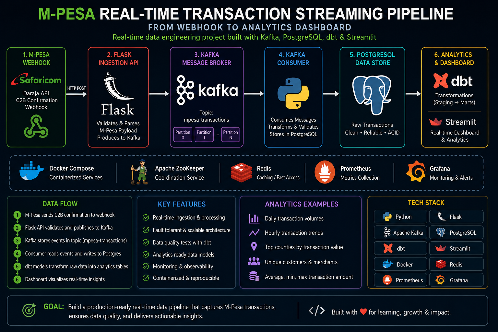

<p align="center">
  
</p>

# M-Pesa Real-Time Transaction Streaming Pipeline

## Category: Real-Time Data Engineering / FinTech Analytics

**Status**: 🟡 Working example (production-like architecture, not production-grade)

---

# Overview

This project demonstrates real-time transaction streaming patterns using Kafka, dbt, and fraud detection. It shows how modern payment systems can ingest, process, and analyze transaction events in near real-time.

**Note**: This is an architectural example, not a live integration with Safaricom. Data sources are simulated or webhook-based for demonstration.

---

# Architecture Flow

```text
Safaricom Daraja API
        ↓
Webhook Receiver (Flask)
        ↓
Kafka Producer
        ↓
Apache Kafka Topic
        ↓
Kafka Consumer / Flink Processing
        ↓
PostgreSQL / BigQuery
        ↓
dbt Transformations
        ↓
Grafana / Streamlit Dashboard
```

---

# Technologies Used

- Python
- Apache Kafka
- Apache Flink
- PostgreSQL
- Google BigQuery
- dbt
- Grafana
- Docker
- Airflow
- Safaricom Daraja API

---

# Quick Start

## Clone Repository

```bash
git clone https://github.com/kipruto45/Real_Time_Transaction_Streaming-MPESA-.git

cd Real_Time_Transaction_Streaming-MPESA-
```

## Start Services

```bash
make docker-up
```

## Health Check

```bash
curl -s http://localhost:5000/health | python -m json.tool
```

## Send Sample Transaction

```bash
curl -s -X POST http://localhost:5000/webhook/c2b/confirmation \
  -H 'Content-Type: application/json' \
  -d '{"TransID":"TXN123","TransAmount":"500","MSISDN":"254712345678","AccountReference":"ACC001","TransTime":"20260514120000"}'
```

---

# Verified Features

- Real-time Kafka streaming
- Webhook ingestion
- PostgreSQL insertion
- dbt transformations
- Dockerized infrastructure
- Automated testing
- Analytics-ready data models
- Integrated fraud detection (ConsolidatedFraudDetectionEngine)

---

# Known Limitations & Gaps

This is a working example, not production-ready. Key limitations:

| Limitation | Impact | Production Workaround |
|-----------|--------|---------------------|
| Single Kafka broker (no replication) | No fault tolerance | Deploy multi-broker setup with replication |
| No exactly-once semantics | Possible duplicate messages | Implement idempotent consumers or duplicate detection |
| Manual Kafka startup | Not fully automated | Use managed Kafka (AWS MSK, Confluent Cloud) |
| No monitoring/alerting | Failures go unnoticed | Add Prometheus + Grafana + alerting rules |
| No error recovery strategy | Poison messages crash service | Implement dead-letter queue pattern |
| No centralized logging | Hard to debug | Add ELK or Datadog logging |
| BigQuery mentioned but not used | Confused documentation | Remove BigQuery references or implement |
| Flink listed but not integrated | Aspirational only | Either remove or integrate Flink |
| No transaction verification | Simulated data only | Add real Daraja API integration |
| Grafana mentioned but not deployed | No monitoring UI | Use Streamlit dashboards or deploy Grafana |

---

# What This Project Demonstrates

✅ Kafka consumer pattern for streaming  
✅ Real-time fraud detection integration  
✅ dbt aggregation models (hourly/daily/summary)  
✅ Docker Compose for local development  
✅ Testing framework (14 integration tests)  
✅ Webhook-based event ingestion  

❌ Production-grade monitoring  
❌ Sub-second latency SLAs  
❌ Distributed transaction handling  
❌ Live Safaricom API integration  
❌ Multi-region failover  

---

# Verified Features

- Real-time Kafka streaming
- Webhook ingestion
- PostgreSQL insertion
- dbt transformations
- Dockerized infrastructure
- Automated testing
- Analytics-ready data models

---

# Author

Victor Kipruto

GitHub: https://github.com/kipruto45